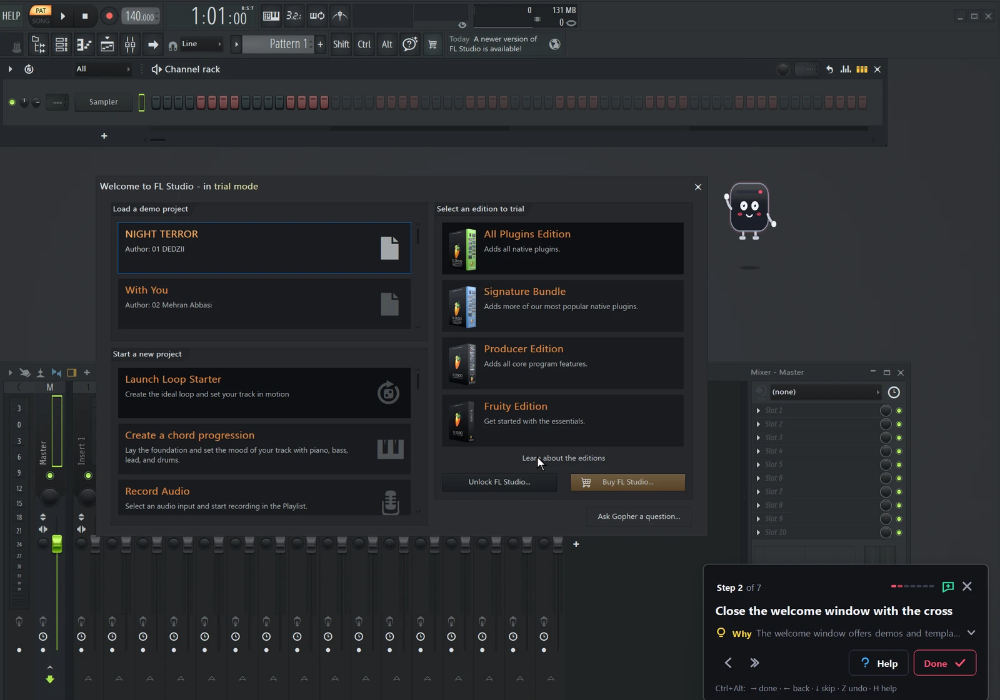

<a href="README.md">English</a> · <a href="README.ru.md">Русский</a> · <b>Español</b> · <a href="README.de.md">Deutsch</a> · <a href="README.zh-CN.md">简体中文</a>

[](https://glama.ai/mcp/servers/kizrum/tutorial_overlay)

Tutoriales paso a paso dibujados directamente sobre cualquier aplicación de Windows, guiados por un agente de IA.



La lección de arriba la recorrió el robot de pruebas del proyecto en FL Studio.

**Muestra dónde. Explica por qué.** Los agentes que hacen clic por ti en una aplicación terminan el trabajo, pero tú
no aprendes nada. TutorialOverlay te deja los clics a ti: señala cada uno y explica por qué es el correcto, para que
la próxima vez no necesites ayuda.

Todo funciona en tu ordenador. El servidor escucha solo en `127.0.0.1` y no envía nada a ningún sitio; no graba la
pantalla y solo hace una captura cuando el agente la pide ([más](docs/server.md#screenshots-and-privacy)).

## Cómo empezar

[Instala TutorialOverlay](#instalación) y pregúntale a tu agente de IA cómo hacer algo en una aplicación:

> [!TIP]
> *«Enséñame paso a paso cómo activar el ajuste de línea en el Bloc de notas»*

El agente lee la interfaz de la aplicación por MCP y escribe la lección: pasos, objetivos y un *por qué* para cada
uno:

```json
{
  "title": "Ajuste de línea en el Bloc de notas",
  "app": "Notepad",
  "lang": "es",
  "steps": [
    {
      "title": "Abre el menú Ver",
      "why": "Todo lo que tiene que ver con cómo se muestra el texto está en el menú Ver.",
      "targets": [{ "name": "Ver", "anchor": { "element": { "name": "Ver", "role": "MenuItem" } } }]
    },
    {
      "title": "Cierra el menú con Esc",
      "until": [{ "type": "key", "keys": "Esc" }]
    }
  ]
}
```

El overlay rodea cada objetivo sobre la aplicación, la mascota lo señala y una tarjeta de pasos te guía. Los pasos
se completan solos: con un clic, un píxel, una ventana, un atajo de teclado, un arrastre o un desplazamiento. ¿Te
atascas? Pulsa **Ayuda** y el agente responde dentro de la tarjeta. Al final puedes guardar la lección y repetirla
desde la bandeja, ya sin el agente.


¿Quieres verlo hecho primero? **Haz este paso** (o **Hazlo todo**) en la tarjeta le pasa el ratón al overlay: mueve
el puntero de verdad y pulsa lo que está enmarcado mientras miras, y una etiqueta azul **AUTO** en la cabecera de la
tarjeta indica que está trabajando. Toca el ratón y el control vuelve a ser tuyo al instante. Lo que no se puede
deshacer (pagar, pedir, borrar para siempre, enviar) nunca lo pulsa: ese botón aparece en rojo con un candado y lo
pulsas tú.

La tarjeta, la bandeja y los ajustes hablan español, inglés, ruso, alemán, francés, portugués, chino y japonés; puedes
añadir tu propio idioma ([cómo](docs/server.md)).

El formato completo de una lección está en [`docs/tutorials.md`](docs/tutorials.md) (en inglés).

## Instalación

> [!NOTE]
> Windows 10 u 11, x64. Nada más: .NET va dentro del exe.

TutorialOverlay es un servidor MCP local, así que cualquier agente que hable MCP puede manejarlo. Descarga
`TutorialOverlay-<versión>-win-x64.zip` de [Releases][releases], descomprímelo (por ejemplo en
`C:\Tools\TutorialOverlay`) y añádelo al `PATH` como `tutorial-overlay`:

```powershell
Copy-Item C:\Tools\TutorialOverlay\TutorialOverlay.exe C:\Tools\TutorialOverlay\tutorial-overlay.exe
$p = [Environment]::GetEnvironmentVariable('Path', 'User')
[Environment]::SetEnvironmentVariable('Path', "$p;C:\Tools\TutorialOverlay", 'User')
```

Después, en **Claude Code**, instala el plugin: el servidor y la skill que enseña al agente a escribir buenas
lecciones:

```text
/plugin marketplace add kizrum/tutorial_overlay
/plugin install tutorial-overlay@tutorial-overlay
```

Eso es todo: ni clave ni puerto. El agente inicia el overlay cuando lo necesita, y se queda en la bandeja hasta que
lo cierras desde su menú.

> [!TIP]
> Claude Code con el plugin funciona mejor. Otros agentes reciben las mismas herramientas y leen la misma skill con
> la herramienta `guide` (desde la 0.7.0), pero sin el hook del plugin que mantiene al agente atento mientras dura
> la lección.

<details>
<summary>Codex</summary>

Añade a `~/.codex/config.toml` (o a `.codex/config.toml` en un proyecto):

```toml
[mcp_servers.tutorial-overlay]
command = "tutorial-overlay"
args = ["--stdio"]
```

</details>

<details>
<summary>Claude Desktop</summary>

En Claude Desktop abre **Settings → Developer → Edit Config** y añade el servidor a `claude_desktop_config.json`
(conserva las demás entradas de `mcpServers`, si las tienes):

```json
{
  "mcpServers": {
    "tutorial-overlay": {
      "command": "C:\\Tools\\TutorialOverlay\\TutorialOverlay.exe",
      "args": ["--stdio"]
    }
  }
}
```

Usa la ruta completa del exe: Claude Desktop puede no ver un `PATH` que cambiaste mientras estaba abierto. Cierra
Claude Desktop por completo (cerrar la ventana puede dejarlo en la bandeja) y ábrelo de nuevo: las herramientas
aparecen en un chat nuevo. Luego pide sin más: *«Enséñame a activar el ajuste de línea en el Bloc de notas».*

</details>

<details>
<summary>Claude Code sin el plugin, otros clientes MCP</summary>

Añade un servidor MCP local (stdio): el comando `tutorial-overlay` (o la ruta completa a `TutorialOverlay.exe`) con
el argumento `--stdio`. En Claude Code:

```powershell
claude mcp add --scope user tutorial-overlay -- tutorial-overlay --stdio
```

No lo añadas así junto al plugin: el agente vería cada herramienta dos veces. Los clientes que hablan Streamable HTTP
también pueden conectarse directamente al overlay en marcha: ver [`docs/server.md`](docs/server.md).

</details>

<details>
<summary>Actualizar</summary>

Cierra TutorialOverlay desde el menú de la bandeja, descomprime la nueva versión sobre la carpeta antigua y vuelve a
copiar `TutorialOverlay.exe` como `tutorial-overlay.exe`. Los ajustes, la clave y los tutoriales guardados están en
`%LOCALAPPDATA%\TutorialOverlay` y se conservan; los ajustes del agente también siguen siendo válidos.

</details>

## Compilar desde el código fuente

Hace falta el [SDK de .NET 8](https://dotnet.microsoft.com/download/dotnet/8.0). Desde la raíz del repositorio:

```powershell
# compilar: publish\TutorialOverlay.exe
dotnet publish -c Release -o publish

# ejecutar las pruebas
dotnet run --project tests

# usar tu compilación en Claude Code
claude mcp add --scope user tutorial-overlay -- "$PWD\publish\TutorialOverlay.exe" --stdio
```

`.\release.ps1` crea el zip de la versión como comprobación; el publicado lo crea
[GitHub Actions](docs/development.md#releases) con la etiqueta de la versión. Cómo está hecho el programa por dentro
se explica en [`docs/development.md`](docs/development.md).

## Referencia (en inglés)

- [Servidor](docs/server.md): opciones de la línea de comandos, el icono de la bandeja, los ajustes, `config.json`, la seguridad, el registro
- [Herramientas y eventos MCP](docs/tools.md): qué puede llamar el agente y qué recibe
- [Tutoriales](docs/tutorials.md): el formato de la lección: formas, anclas, pasos y condiciones, la mascota, la ayuda
- [Desarrollo](docs/development.md): el interior del programa, las pruebas, el robot de pruebas

## Licencia

[MIT](LICENSE)

***


Shazhok te saluda. Como todo lo demás aquí, está dibujado en código: sin imágenes, sin fuentes, sin paquetes.

[releases]: https://github.com/kizrum/tutorial_overlay/releases/latest
