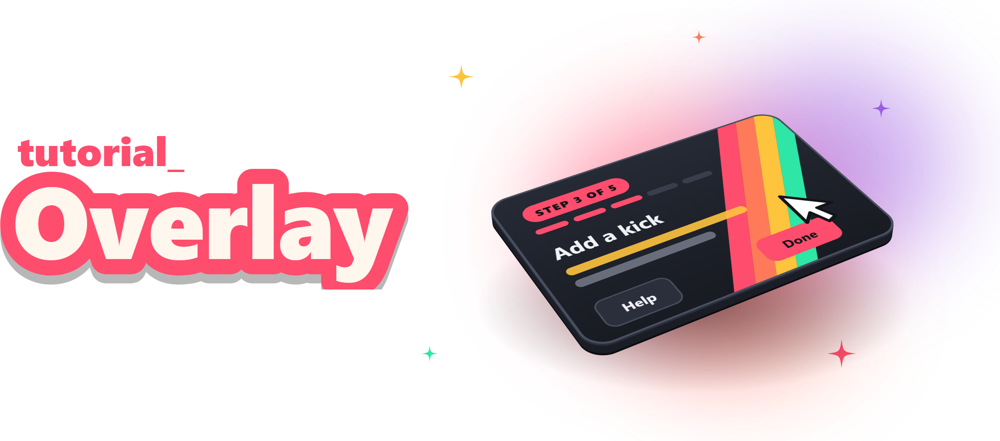
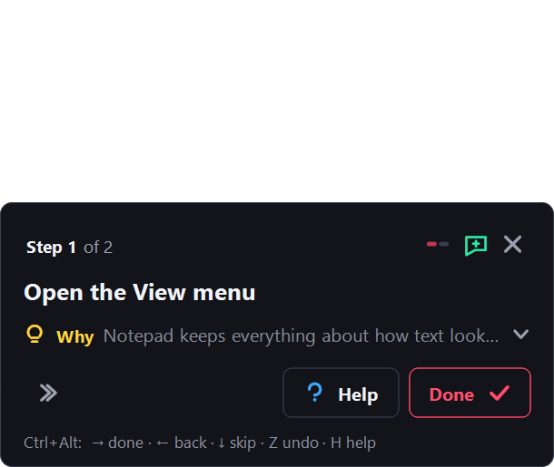

<a href="README.md">English</a> · <a href="README.ru.md">Русский</a> · <a href="README.es.md">Español</a> · <a href="README.de.md">Deutsch</a> · <b>简体中文</b>

[](https://glama.ai/mcp/servers/kizrum/tutorial_overlay)

直接画在任何 Windows 程序之上的分步教程，由 AI 代理带领。


上面这节课是项目的测试机器人在 FL Studio 中完成的。

**指出在哪里，讲清为什么。** 替你在程序里点来点去的代理能把事情做完，你却什么也没学到。TutorialOverlay
把点击留给你：它指出每一处该点的地方，并说明为什么是它，下次你就不再需要帮助。

一切都在你的电脑上运行。服务器只监听 `127.0.0.1`，不向任何地方发送数据；它不录屏，只在代理请求时截一张图
（[详情](docs/server.md#screenshots-and-privacy)）。

## 开始使用

[安装 TutorialOverlay](#安装)，然后问你的 AI 代理在某个程序里怎么做一件事：

> [!TIP]
> *“一步步教我在记事本里打开自动换行”*

代理通过 MCP 读取程序的界面，写出课程：步骤、目标，以及每一步的*为什么*：

```json
{
  "title": "记事本中的自动换行",
  "app": "Notepad",
  "lang": "zh-Hans",
  "steps": [
    {
      "title": "打开“查看”菜单",
      "why": "文字如何显示的设置都在“查看”菜单里。",
      "targets": [{ "name": "查看", "anchor": { "element": { "name": "查看", "role": "MenuItem" } } }]
    },
    {
      "title": "按 Esc 关闭菜单",
      "until": [{ "type": "key", "keys": "Esc" }]
    }
  ]
}
```

叠加层在程序上方圈出每个目标，吉祥物指向它，步骤卡片带你往下走。步骤会自动完成——一次点击、一个像素、一个
窗口、一个快捷键、一次拖动、一次滚动。卡住了？点击**帮助**，代理会直接在卡片里回答。课程结束后可以保存，之后
从托盘再次学习，不需要代理。



想先看一遍怎么做？卡片上的**帮我做这步**（或**全部帮我做**）会把鼠标交给叠加层：它移动真实的指针，点击框出的
地方，你在一旁看着；卡片顶部蓝色的 **AUTO** 表示它正在操作。你一碰鼠标，控制权立刻回到你手中。无法撤销的操作
——付款、下单、永久删除、发送——它从不点击：这样的按钮显示为带锁的红色，由你自己来按。

卡片、托盘和设置支持中文、英语、俄语、西班牙语和德语；也可以加入你自己的语言（[方法](docs/server.md)）。

课程的完整格式见 [`docs/tutorials.md`](docs/tutorials.md)（英文）。

## 安装

> [!NOTE]
> Windows 10 或 11，x64。别的都不需要：.NET 已包含在 exe 中。

TutorialOverlay 是本地 MCP 服务器，任何支持 MCP 的代理都能驱动它。从 [Releases][releases] 下载
`TutorialOverlay-<版本>-win-x64.zip`，解压（例如到 `C:\Tools\TutorialOverlay`），并以 `tutorial-overlay`
的名字加入 `PATH`：

```powershell
Copy-Item C:\Tools\TutorialOverlay\TutorialOverlay.exe C:\Tools\TutorialOverlay\tutorial-overlay.exe
$p = [Environment]::GetEnvironmentVariable('Path', 'User')
[Environment]::SetEnvironmentVariable('Path', "$p;C:\Tools\TutorialOverlay", 'User')
```

然后在 **Claude Code** 中安装插件——服务器，以及教代理写出好课程的 skill：

```text
/plugin marketplace add kizrum/tutorial_overlay
/plugin install tutorial-overlay@tutorial-overlay
```

就这样：不需要密钥，也不需要端口。代理在需要时启动叠加层，它会一直留在托盘里，直到你从托盘菜单中退出。

> [!TIP]
> Claude Code 配合插件效果最好。其他代理也能拿到同样的工具，并通过 `guide` 工具读取同一份 skill（自 0.7.0
> 起），但没有插件的 hook，课程进行时无法让代理一直保持关注。

<details>
<summary>Codex</summary>

在 `~/.codex/config.toml`（或项目中的 `.codex/config.toml`）里加入：

```toml
[mcp_servers.tutorial-overlay]
command = "tutorial-overlay"
args = ["--stdio"]
```

</details>

<details>
<summary>Claude Desktop</summary>

在 Claude Desktop 中打开 **Settings → Developer → Edit Config**，把服务器加入 `claude_desktop_config.json`
（如果 `mcpServers` 里已有其他条目，请保留）：

```json
{
  "mcpServers": {
    "tutorial-overlay": {
      "command": "C:\\Tools\\TutorialOverlay\\TutorialOverlay.exe",
      "args": ["--stdio"]
    }
  }
}
```

请使用 exe 的完整路径：Claude Desktop 运行期间修改的 `PATH` 它可能看不到。完全退出 Claude Desktop（关闭窗口后
它可能仍在托盘中运行），再重新打开：工具会出现在新的对话中。然后直接问：*“教我在记事本里打开自动换行。”*

</details>

<details>
<summary>不使用插件的 Claude Code、其他 MCP 客户端</summary>

添加一个本地（stdio）MCP 服务器：命令 `tutorial-overlay`（或 `TutorialOverlay.exe` 的完整路径），参数
`--stdio`。在 Claude Code 中：

```powershell
claude mcp add --scope user tutorial-overlay -- tutorial-overlay --stdio
```

不要在已装插件的情况下再这样添加：代理会把每个工具看到两次。支持 Streamable HTTP 的客户端也可以直接连接正在
运行的叠加层——见 [`docs/server.md`](docs/server.md)。

</details>

<details>
<summary>更新</summary>

从托盘菜单退出 TutorialOverlay，把新版本解压到旧文件夹上，再把 `TutorialOverlay.exe` 复制为
`tutorial-overlay.exe`。设置、密钥和保存的教程都在 `%LOCALAPPDATA%\TutorialOverlay` 中，保持不变；代理的设置
也依然有效。

</details>

## 从源码构建

需要 [.NET 8 SDK](https://dotnet.microsoft.com/download/dotnet/8.0)。在仓库根目录下：

```powershell
# 构建：publish\TutorialOverlay.exe
dotnet publish -c Release -o publish

# 运行测试
dotnet run --project tests

# 在 Claude Code 中使用你的构建
claude mcp add --scope user tutorial-overlay -- "$PWD\publish\TutorialOverlay.exe" --stdio
```

`.\release.ps1` 会构建发布用的 zip 作为检查；正式发布的版本由 [GitHub Actions](docs/development.md#releases)
在发布标签上构建。程序内部的结构见 [`docs/development.md`](docs/development.md)。

## 参考（英文）

- [服务器](docs/server.md)——命令行选项、托盘图标、设置、`config.json`、安全、日志
- [MCP 工具和事件](docs/tools.md)——代理可以调用什么、会得到什么
- [教程](docs/tutorials.md)——课程格式：形状、锚点、步骤和条件、吉祥物、帮助
- [开发](docs/development.md)——程序内部、测试、测试机器人

## 许可证

[MIT](LICENSE)

***


Shazhok 向你问好。和这里的其他一切一样，它是用代码画出来的——没有图片、没有字体、没有依赖包。

[releases]: https://github.com/kizrum/tutorial_overlay/releases/latest
